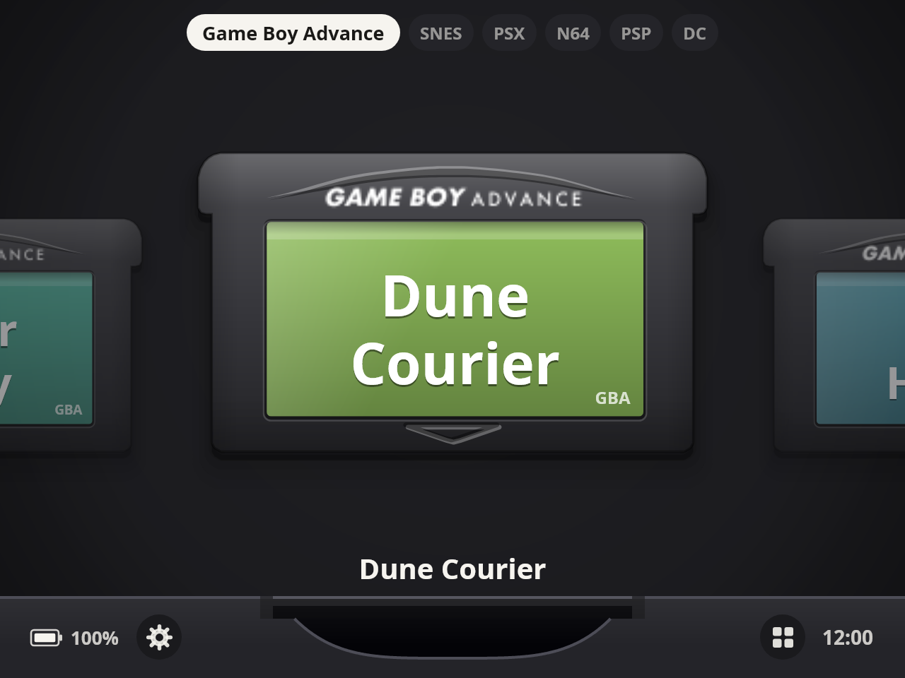
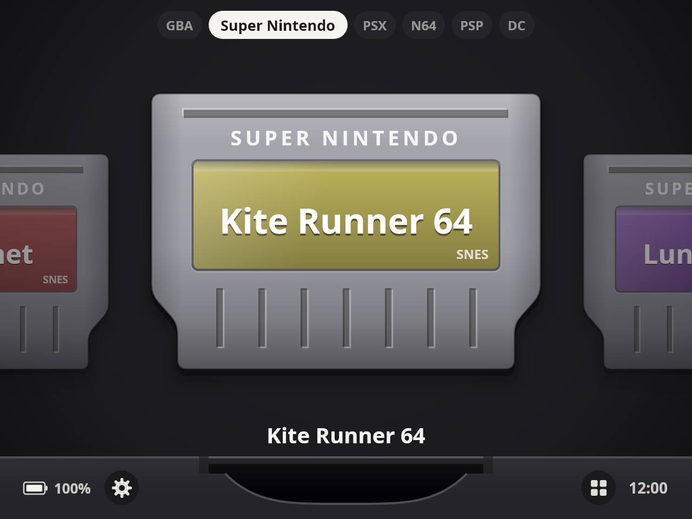
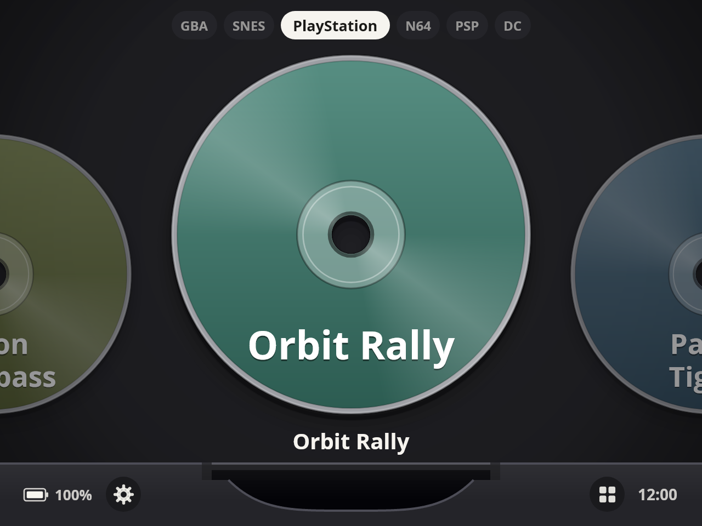
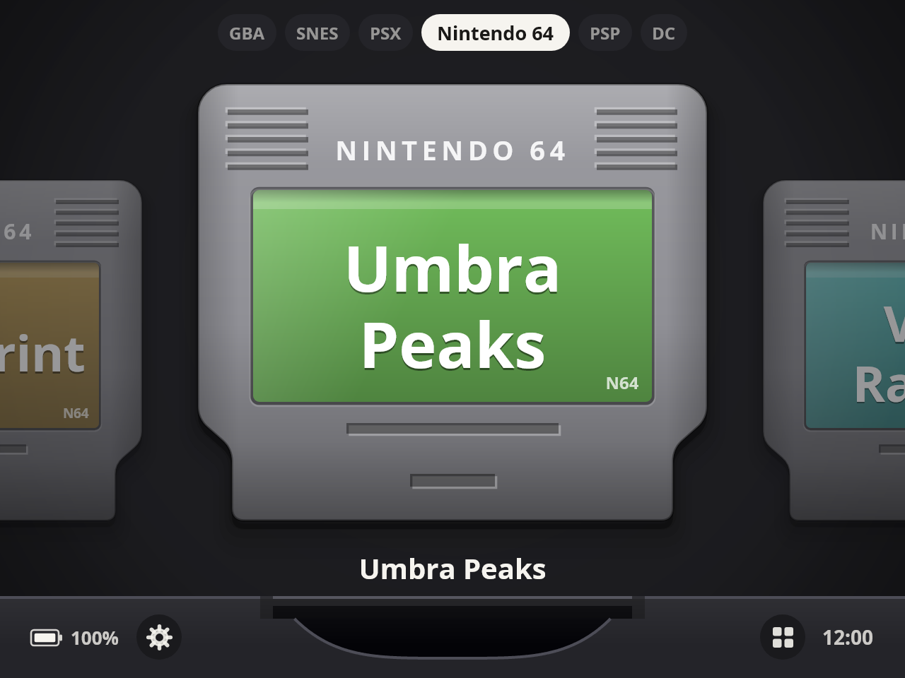
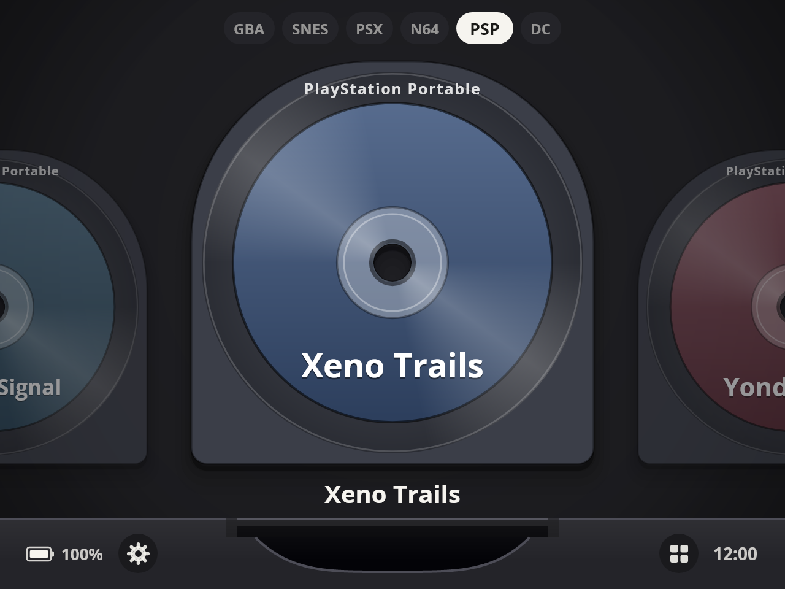
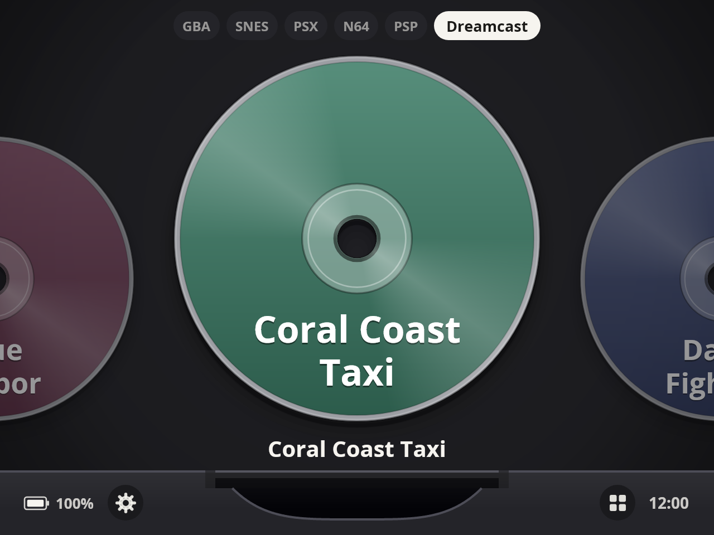
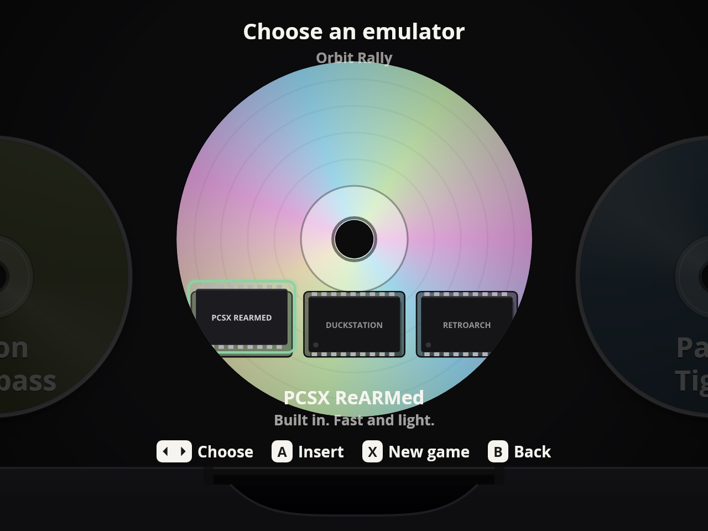
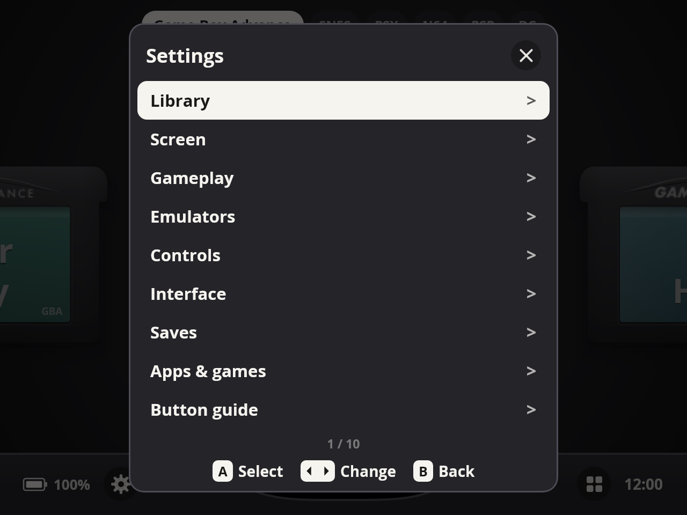
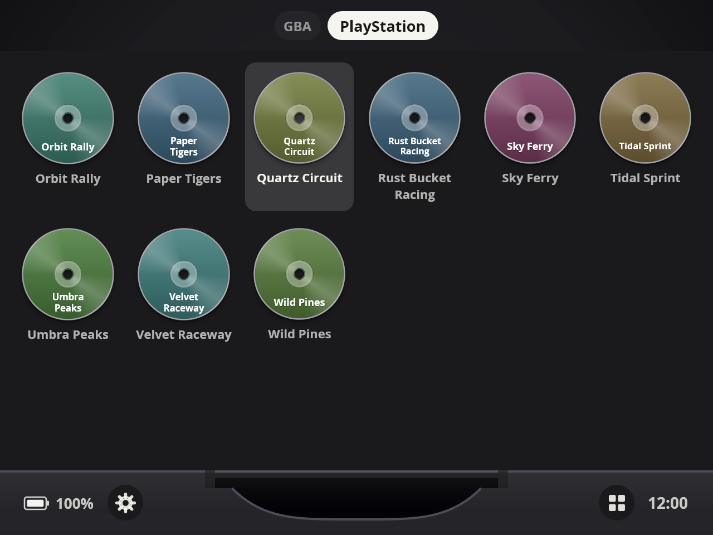
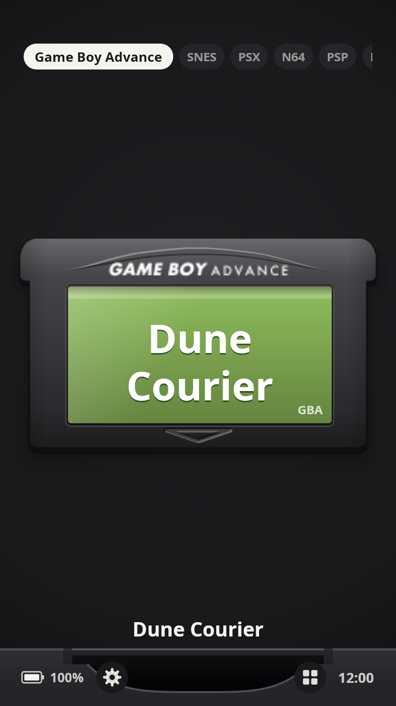

# slot. for Android

An Android port of [slot](https://slot-cfw.fyi), Brandon Kowalski's Game Boy-style frontend for the Anbernic RG SP,
extended to many more systems, to touch screens and to the emulator apps you already have.

You get the same cart shelf, the same slot you push carts into, a board you flip over to choose an emulator, polaroid-style
save states, and the same motion: a critically damped shelf spring, the "catch" when a cart meets the contacts,
neighbours sliding aside, the screen dimming into the game.

| | |
|---|---|
| Built in | GBA, GB, GBC, NES, SNES, Mega Drive/Genesis, Master System, Game Gear, PC Engine, PlayStation, N64, PSP (Dreamcast experimental) |
| Opens your apps | PS2, GameCube, Dreamcast, Xbox, PS3, Xbox 360, plus RetroArch for any built-in system, and your Android apps and games |
| Cores | mGBA, gpSP, Gambatte, FCEUmm, Snes9x, Genesis Plus GX, Beetle PCE Fast, PCSX ReARMed, Mupen64Plus-Next, PPSSPP, Flycast (libretro, via [LibretroDroid](https://github.com/Swordfish90/LibretroDroid)) |
| Input | Gamepad first (handhelds); touch with flicks and momentum, on-screen buttons you can move and resize |
| Target | Android 8+, arm64 |

Tested on an Anbernic RG476H (Android 13, 1280×960), an Anbernic RG Rotate (720×720), an Android tablet and a Samsung S25 Ultra.

**Download:** the latest APK is attached to every [release](https://github.com/nikunjsingh93/slot-ui-android/releases/latest).
New versions install over old ones and keep your settings and saves.

## Screenshots

Captured from slot's own renderer at 1280 × 960 (the RG476H's resolution), using made-up game names so no real titles
or box art appear. With your own games the labels show title screens and box art downloaded for each game.

| Game Boy Advance | Super Nintendo | PlayStation |
|:---:|:---:|:---:|
|  |  |  |

| Nintendo 64 | PSP | Dreamcast |
|:---:|:---:|:---:|
|  |  |  |

| Choose an emulator (START) | Settings | Grid view |
|:---:|:---:|:---:|
|  |  |  |

| Portrait (touch) |
|:---:|
|  |

## Getting started

1. Install the APK. On a handheld you can also pick **slot.** as your home app.
2. Press **A** on the empty shelf (or tap it) and choose your ROM folder. Games may be loose files or `.zip`s.
   Alternatively drop ROMs into `Android/data/fyi.slot.android/files/roms` and no permission is needed.
3. Put games in folders named after their system. Names are matched loosely, so `GBA`, `PSX`, `PS1`, `Sony PlayStation`,
   `N64`, `Nintendo 64`, `GC`, `Game Cube`, `NGC`, `DC`, `Dreamcast`, `Sega Dreamcast (Games)`, `PS2`, `PSP`, `PS3`,
   `Xbox`, `X360`, `Xbox 360`, `Mega Drive`, `Super Nintendo` and so on all work, anywhere in the folder you picked.
   BIOS files lying next to the games (`scph5501.bin`, `dc_boot.bin`, ...) are ignored.
4. The first time you start a PlayStation, N64, PSP or Dreamcast game inside slot, it asks once for Android's
   **All files access**: those emulators read the game where it is instead of copying a disc image.
5. Cart art is fetched once and cached: first from the libretro thumbnail server (file names are matched loosely, so
   `Gran Turismo 4.iso` still finds `Gran Turismo 4 (USA)`), then from the game's Wikipedia page. Put your own
   `<rom name>.png` into `Android/data/fyi.slot.android/files/labels` to override it, or turn the download off in
   **Settings > Library**.

**BIOS files** go in `Android/data/fyi.slot.android/files/system`. **gpSP** needs `gba_bios.bin` there (without it slot
quietly uses mGBA). For **Flycast** (Dreamcast) put `dc_boot.bin` and `dc_flash.bin` in your Dreamcast folder and slot
copies them over. No BIOS, firmware or games are included with slot.

## Browsing the shelf

| Button | On the shelf |
|---|---|
| Left / Right | previous / next game (hold to speed up) |
| L2 / R2 | previous / next game |
| L1 / R1 | previous / next system |
| Up / Down | jump to the previous / next letter (list view: one game; grid view: one row) |
| A | play: a tap resumes where you stopped, holding it starts the game fresh |
| START | flip the cart over to choose the emulator for this game |
| Y | app drawer |
| MENU / SELECT | settings |

**Touch:** swipe the shelf (a quick flick keeps it sliding and slowing down, like scrolling on a phone), tap a cart to
select it and tap the selected one to play. While you swipe, a row of **letters** appears under the system bar; tap one
to jump to the first game with that letter. It fades out a couple of seconds after you stop. The bottom bar has a
**gear** (settings) beside the battery and an **apps** button beside the clock. Tap a system's name at the top to switch.

**Shelf view** (**Settings > Interface > Shelf view**):

- **Carts**: slot's own shelf, carts side by side.
- **List + cart**: a list of the games on the left, between the system bar and the bottom bar, and the carts stacked top
  to bottom with the slot on the right. The white highlight stays fixed in the middle and the names roll through it with
  the carts, like a slot machine; the list wraps round from the last game to the first, and small letter headings mark
  where each letter starts. **List text size** (Small, Medium, Large, Extra large) is in the same menu.
- **Grid**: every game of the system at once, as a grid of its carts and discs with their art, so you can see many
  games together. Up/Down move a row, Left/Right a game; tap a game to select it and tap it again to play (long-press
  for the emulator picker). **Cart size** sets how big the tiles are. Starting a game drops its cart into the slot as usual.

The interface keeps the same size when the device is turned, and on 8-inch and larger tablets it is automatically drawn
at a handheld's size instead of being blown up; **Settings > Interface > Interface scale** (60-135%) adjusts it further.

**Cart size** (Extra small to Extra large) is also under **Settings > Interface**. If your handheld reports A/B the
other way round, flip **Settings > Controls > Swap A/B and X/Y**.

## Systems and emulators

| System | Default | Other choices | Files |
|---|---|---|---|
| Game Boy Advance | mGBA (built in) | gpSP, RetroArch | `.gba` |
| Game Boy / Color | Gambatte (built in) | mGBA, RetroArch | `.gb`, `.gbc` |
| NES, SNES, Mega Drive, Master System, Game Gear, PC Engine | built in (FCEUmm, Snes9x, Genesis Plus GX, Beetle PCE Fast) | RetroArch | the usual ROM files, also in `.zip` |
| PlayStation | PCSX ReARMed (built in) | DuckStation, RetroArch | `.chd`, `.cue` (the `.bin` beside it is hidden), `.pbp`, `.iso` |
| Nintendo 64 | Mupen64Plus-Next (built in) | M64Plus FZ (Pro), RetroArch | `.z64`, `.n64`, `.v64`, `.zip` |
| PSP | PPSSPP (built in) | PPSSPP app, RetroArch | `.iso`, `.cso`, `.pbp`, `.chd` |
| Dreamcast | Redream | Flycast (built in, experimental), RetroArch | `.chd`, `.gdi`, `.cdi`, `.cue` |
| PlayStation 2 | ARMSX2 | AetherSX2 / NetherSX2 | `.iso`, `.chd`, `.cso`, `.cue` |
| GameCube | Dolphin | Dolphin MMJR / MMJR2 | `.iso`, `.ciso`, `.gcm`, `.rvz`, `.gcz`, `.wbfs` |
| Xbox | hakuX | | `.iso`, `.xiso` |
| PlayStation 3 | ARMSX3 | | `.iso` |
| Xbox 360 | Xendroid+ | | `.iso`, `.xex`, `.zar` |

- **Choosing:** press **START** on a game to flip it over and pick the emulator just for that game. To change the default
  for a whole system, use **Settings > Emulators**. If the default emulator app is not installed, the next one is used.
- **Emulator apps** are opened straight into the game. When you quit the emulator and come back to slot, the disc pops
  back out of the slot. Phones without "all files access" for the emulator are handled too: slot hands it the game
  through a permission-granted link.
- **RetroArch** is offered for every built-in system. Slot opens it with the same libretro core it bundles, so download
  that core once in RetroArch's Online Updater.
- **Dreamcast:** the built-in Flycast still shows only a black screen on the devices tested, so Redream is the default.
- **PSP** games are drawn as UMDs, PlayStation, Dreamcast, PS2 and GameCube games as discs with their cover art.

## Playing

The pause menu, save states and the rest of this section apply to the systems slot runs itself. Emulator apps have
their own menus and their own saves.

- **In-game saves** (battery saves) are written for you every few seconds while you play and again when you eject.
- **Pause menu:** press **MENU** (on a touchscreen tap the **MENU** pill at the top). It starts with **Eject**, so Back
  then A quits, followed by **Resume**, **Save states**, **Quick save**, **Quick load**, **Fast forward**, **Screen**,
  **Gameplay**, **Controls** and **Reset game**.
- **Quick save / Quick load** use slot 1, one press each.
- **Save states:** press **MENU twice quickly** (or pick **Save states**) to open a row of polaroids with a screenshot
  of each slot. Slot 0 is the automatic one, slot 1 is quick save and slots 2 to 8 are yours.

  | Button | In the state switcher |
  |---|---|
  | Left / Right | pick a slot |
  | **A** | load the slot (on an empty slot it saves there instead) |
  | **Y** | save to the slot, replacing what is there |
  | **X** | delete the slot |
  | **SELECT** | undo the last load |
  | **B** or **MENU** | back to the game |

  On a touchscreen tap a card to select it and tap it again to load it.
- **Auto-resume:** **Eject** saves an automatic state in slot 0 (turn it off in **Settings > Gameplay > Auto-save on
  eject**). Next time a quick press of **A** resumes exactly where you stopped and holding **A** starts fresh.
- **Rewind** (hold **L2**) and **Fast forward** (hold **R2**, or double-tap **R2** to lock it) are on the handheld
  systems. On PlayStation, N64, PSP and Dreamcast, L2 and R2 are the game's own buttons instead.
- **X / Y** act as turbo A / B on systems without those buttons (GB, GBA, NES, Master System, Game Gear, PC Engine).
- **On-screen controls** appear when no controller is connected (**Settings > Controls > On-screen controls**).
  PlayStation, PSP and Dreamcast get the four face buttons and two shoulder rows; N64 gets an analog stick, C buttons and Z.
- **Edit button layout** (**Settings > Controls**, also in the pause menu): pick a system, then drag the d-pad or the
  buttons to move them and pinch to resize them. **Reset** puts the defaults back. Each system keeps its own layout.
- **Portrait:** the game picture sits a little below the top edge so the buttons have room; move it with
  **Settings > Screen > Screen position (portrait)**.

States and battery saves live inside slot's own storage (`files/states` and `files/saves`): updates keep them, an
uninstall removes them.

### Moving saves to another device

**Settings > Saves**:

- **Export all saves** writes one zip with every game's save and save states to a place you choose.
- **Import saves** reads such a zip back. Saves go to the game with the same system and name, so the same games must be
  in the library on both devices.
- **Download save** / **Upload save** do the same for the game selected on the shelf (upload works even if the file is
  named differently on this device). An existing save is kept as `.srm.bak` before it is replaced.

Save states only load in the same version of the same emulator core; the in-game save is the part that always moves.

## Android apps and games

Nothing is shown by default. Open **Settings > Apps & games** to see every app on the device (Android's own "game"
tag is shown next to the ones it thinks are games) and set each one to **Hidden**, **App** or **Game**. Apps get an
**Apps** shelf and games an **Installed** shelf, as square Switch-style cards with the app icon on the face. They slide
into the slot like any other cart, and coming back to slot ejects them.

Your Apps & games choices and settings are also copied to a hidden `.slot-backup.json` in your ROM folder, so after a
reinstall, picking the same folder again brings them back.

### App drawer

Press **Y** (or tap the grid button beside the clock) to open a launcher with every app on the device, as a grid or a
list. D-pad moves, **A** opens, **Y** (or a long press) shows **Open / App info / Uninstall**, **X** flips grid/list and
**L1/R1** change the icon size. Layout and size are also in **Settings > Interface**.

## Settings at a glance

| Section | What is in it |
|---|---|
| Library | choose the ROM folder, rescan, cart art download |
| Screen | shaders, colour correction, Game Boy palette, brightness, portrait screen position |
| Gameplay | fast-forward speed and sound, rewind, turbo, rumble, auto-save on eject |
| Emulators | the default emulator for each system that has more than one |
| Controls | on-screen controls, edit button layout, swap A/B and X/Y, interface sounds |
| Interface | cart size, interface scale (60-135%), list text size, shelf view, app drawer layout and size |
| Button guide, About | the buttons on one page; version and credits |
| Saves | export / import all saves, download / upload one game's save |
| Apps & games | show Android apps on the Apps or Installed shelf |

## Building

Requirements: JDK 17 and the Android SDK (platform 35, build-tools 35). On a new machine, create `local.properties`
containing `sdk.dir=/path/to/Android/Sdk` (Android Studio does this for you when you open the project).

```bash
scripts/fetch-cores.sh          # downloads the arm64 libretro cores into app/src/main/jniLibs
./gradlew :app:assembleDebug    # app/build/outputs/apk/debug/app-debug.apk
./gradlew :app:assembleRelease  # app/build/outputs/apk/release/app-release.apk
```

Every build (debug or release, on any computer) is signed with the key in `app/slot-signing.keystore`, so a new APK
always updates the installed app in place and keeps its data. It is a plain debug key and is public on purpose; never
swap it for another one, or Android will insist on an uninstall, which wipes the app's settings and saves.

The UI lives in `ui/`, a Kotlin Multiplatform Compose module, so it can also be rendered headlessly on a desktop:

```bash
./gradlew :ui:renderPreviews -Pout=$PWD/build/previews -Pscene=readme   # the README screenshots
./gradlew :ui:renderPreviews -Pout=$PWD/build/previews -Pscene=anim     # PNG filmstrips of the motion
```

The game runs in its own process (`GameActivity`, `:game`) so a core that crashes can't take the launcher with it.
Notes for contributors and AI coding agents are in `AGENTS.md` and `.ai/`.

## Notes

* All motion is driven by the frame clock instead of Compose's animation APIs. Many handhelds set the system
  "animator duration scale" to 0, which would otherwise freeze every animation.
* Not done yet: link-cable play, Cart Studio labels, a working built-in Dreamcast (Flycast).

## Credits and licences

* **slot** by Brandon Kowalski, GPL-3.0: the design, the cart/board/socket artwork, colour tables and motion constants
  are taken from <https://github.com/BrandonKowalski/slot>. This port is therefore also GPL-3.0 (see `LICENSE`).
* Open Sans (OFL) for the lettering, from slot's assets.
* [LibretroDroid](https://github.com/Swordfish90/LibretroDroid) (GPL-3.0) and the libretro cores, each under its own licence
  (mGBA MPL-2.0, gpSP GPL-2.0, Gambatte GPL-2.0, FCEUmm GPL-2.0, Beetle PCE Fast GPL-2.0, PCSX ReARMed GPL-2.0,
  Mupen64Plus-Next GPL-2.0, PPSSPP GPL-2.0, Flycast GPL-2.0;
  Snes9x and Genesis Plus GX are free for non-commercial use only, so slot must not be sold).
* Emulator apps that slot opens (DuckStation, AetherSX2/NetherSX2, ARMSX2, ARMSX3, Dolphin, PPSSPP, Redream,
  M64Plus FZ, hakuX, Xendroid+, RetroArch) are separate projects, installed by you.
* No games, BIOS or firmware are included; you supply your own.
* Thumbnails come from the libretro thumbnail server and Wikipedia.
